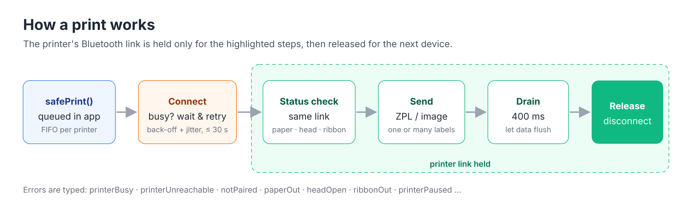
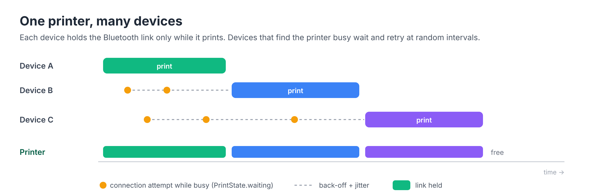

# zebra_printer 🦓

[](https://pub.dev/packages/zebra_printer)
[](https://pub.dev/packages/zebra_printer/score)
[](https://github.com/Sameetdmr/zebra_printer/actions/workflows/ci.yml)
[](https://pub.dev/packages/zebra_printer)
[](https://opensource.org/licenses/MIT)

**Bluetooth for Flutter, plus Zebra label printing with the official Zebra Link-OS™ SDK — in one package.**

The package has two independent parts. Use either one on its own, or both together:

| | `BluetoothManager` | `PrinterManager` |
|---|---|---|
| **For** | Any Bluetooth Classic device | Zebra printers |
| **Does** | Bluetooth on/off check, paired devices, scanning (streams), pairing, connection state | ZPL / image printing, real printer status, fonts, calibration |
| **Built on** | Android Bluetooth API | Zebra Link-OS SDK 2.17.5585 |
| **Needs a Zebra printer?** | No | Yes |

## Features

**Bluetooth (`BluetoothManager`)**

- 📶 Check whether Bluetooth is on
- 📋 List paired (bonded) devices
- 🔍 Scan for nearby devices with live streams (`onDeviceFound`, `onScanStateChanged`)
- 🤝 Pair and unpair devices
- 🔗 Connect / disconnect with connection-state stream

**Zebra printing (`PrinterManager`)**

- 🖨️ Print ZPL labels, one at a time or in batches
- 🖼️ Print images (PNG / JPG / BMP / WebP)
- 📊 Real printer status: paper out, head open, ribbon out, paused
- 🤝 Shared-printer friendly: connect → print → release; waits for a busy printer instead of failing
- 🧯 Typed errors (`printerBusy`, `paperOut`, `notPaired`, …) and progress events
- 🔤 Font upload, media calibration, raw SGD commands, Zebra printer discovery

## Contents

- [Requirements](#requirements)
- [Installation and permissions](#installation-and-permissions)
- **Part 1 — Bluetooth:** [BluetoothManager](#part-1--bluetooth-bluetoothmanager)
- **Part 2 — Zebra printing:** [PrinterManager](#part-2--zebra-printing-printermanager)
  - [Getting started](#getting-started) · [Common tasks](#common-tasks) · [Sharing one printer](#sharing-one-printer-between-many-devices) · [Options](#options) · [Error handling](#error-handling) · [More features](#more-features)
- [Using both together](#using-both-together)
- [Troubleshooting](#troubleshooting)
- [Example app](#example-app)

---

## Requirements

| | |
|---|---|
| **Platform** | Android (iOS is planned, not available yet) |
| **Android** | minSdk 21. Zebra tests SDK 2.17 on Android 15, 16 and 17 |
| **Flutter** | 3.29 or newer (Dart 3.7.2+) |
| **Bluetooth** | Bluetooth Classic |
| **Printers** (`PrinterManager`) | Link-OS printers: ZQ, ZD, ZT, ZR, ZE, QLn series. Older ZebraLink printers (e.g. iMZ) work with reduced functionality |

---

## Installation and permissions

```yaml
dependencies:
  zebra_printer: ^0.6.1
```

The plugin declares the Bluetooth permissions in its Android manifest. Your app still has to **ask the user at runtime** (both parts need this). With [permission_handler](https://pub.dev/packages/permission_handler):

```dart
import 'package:permission_handler/permission_handler.dart';

Future<bool> requestBluetoothPermissions() async {
  final statuses = await [
    Permission.bluetoothScan,     // Android 12+
    Permission.bluetoothConnect,  // Android 12+
    Permission.locationWhenInUse, // Android 11 and lower (scanning)
  ].request();
  return statuses[Permission.bluetoothConnect]?.isGranted ?? false;
}
```

---

## Part 1 — Bluetooth (`BluetoothManager`)

General Bluetooth Classic features. Works with any device — headsets, scanners, other printers — no Zebra printer needed.

```dart
import 'package:zebra_printer/zebra_printer.dart';

final bt = BluetoothManager(); // singleton
```

### Is Bluetooth on?

```dart
if (!await bt.isBluetoothEnabled()) {
  print('Please turn on Bluetooth');
}
```

### Paired devices

```dart
final paired = await bt.getBondedDevices();
for (final d in paired) {
  print('${d.name ?? 'Unknown'}  ${d.address}  ${d.type.name}');
}
```

### Scan for nearby devices

New devices arrive through `onDeviceFound`. `bt.devices` starts with the paired devices and collects everything found during the scan.

```dart
final foundSub = bt.onDeviceFound.listen((device) {
  print('Found: ${device.name} (${device.address})');
});
final scanSub = bt.onScanStateChanged.listen((state) {
  print('Scan: ${state.name}'); // starting → scanning → idle
});

await bt.startDiscovery(); // runs until finished (~12 s) or stopped
// ...
await bt.stopDiscovery();

// When you no longer need updates
await foundSub.cancel();
await scanSub.cancel();
```

`bt.onDiscoveryFinished` fires when the scan ends.

### Pair and unpair

```dart
await bt.pairDevice('00:11:22:33:44:55');   // Android shows its pairing dialog
await bt.unpairDevice('00:11:22:33:44:55');
```

### Connect and follow the connection state

```dart
bt.onConnectionStateChanged.listen((state) {
  print('Connection: ${state.name}'); // connecting → connected → disconnected
});

await bt.connect('00:11:22:33:44:55'); // opens an RFCOMM (SPP) connection
print(bt.isConnected);                // true once connected
print(bt.connectedDevice?.name);

await bt.disconnect();
```

`connect` keeps the connection open until `disconnect`. It tracks the connection state; it does not expose a data read/write API.

> **Zebra printers:** don't `connect` to a printer here before printing. A printer accepts only one Bluetooth connection, so a connection held by `BluetoothManager` blocks `PrinterManager` and every other device. `PrinterManager` opens its own connection for each print.

### The `BluetoothDevice` model

| Field | Type | |
|---|---|---|
| `name` | `String?` | Device name (null if unknown or permission missing) |
| `address` | `String` | MAC address |
| `type` | `BluetoothDeviceType` | `classic`, `le`, `dual`, `unknown` |
| `bondState` | `BluetoothBondState` | `none`, `bonding`, `bonded` |
| `isConnected` | `bool` | Connected through `BluetoothManager` |

---

## Part 2 — Zebra printing (`PrinterManager`)

Printing on Zebra printers through the official Zebra Link-OS SDK: real printer status, batch and image printing, fonts. Each print connects, sends and **releases the printer right away**, so several devices can share one printer.

<p align="center">
  
</p>

### Getting started

```dart
import 'package:zebra_printer/zebra_printer.dart';

final printer = PrinterManager(); // singleton

Future<void> printHello() async {
  // Find paired printers (or use printer.startDiscovery() for nearby Zebra printers).
  // Store the MAC address once; you do not need to discover before every print.
  final paired = await printer.getPairedPrinters();
  final mac = paired.first.address; // e.g. "AC:3F:A4:12:34:56"

  try {
    await printer.safePrint(mac, '^XA^FO50,50^A0N,50,50^FDHello Zebra!^FS^XZ');
    print('Printed');
  } on ZebraPrinterException catch (e) {
    print('Print failed: ${e.code.name} - ${e.message}');
  }
}
```

`safePrint` connects, checks the printer, sends the label and disconnects.

> **New to ZPL?** ZPL is Zebra's label language. `^XA` starts a label, `^FO` sets a position, `^A0` picks a font, `^FD…^FS` is the text and `^XZ` ends the label. Try your labels in the [Labelary online viewer](https://labelary.com/viewer.html).

### Common tasks

**Show progress**

```dart
printer.onPrintProgress = (p) {
  switch (p.state) {
    case PrintState.waiting:
      setStatus('Printer busy, waiting... (${p.waited?.inSeconds ?? 0}s)');
    case PrintState.completed:
      setStatus('Printed ✅');
    case PrintState.error:
      setStatus('Error: ${p.errorCode?.name}');
    default:
      setStatus('${p.state.name} ${p.percentage}%');
  }
};
```

**Print many labels at once**

```dart
final labels = [
  for (var i = 1; i <= 10; i++) '^XA^FO50,50^A0N,40,40^FDBox $i of 10^FS^XZ',
];
await printer.safeBatchPrint(mac, labels); // one connection for all labels
```

**Print an image**

```dart
final bytes = (await rootBundle.load('assets/logo.png')).buffer.asUint8List();
await printer.printImage(mac, bytes, x: 20, y: 20, width: 300); // sizes in dots, 0 = original
```

**Check the printer status**

```dart
final status = await printer.getZebraPrinterStatus(mac); // never throws
if (status.canPrint) {
  print('Ready');
} else {
  print(status.statusMessage); // e.g. "🔴 Paper out!"
}
```

You don't need to check the status before printing: `safePrint` already does it on the same connection and fails with `paperOut`, `headOpen`, `ribbonOut` or `printerPaused`.

**Read printer details**

```dart
final info = await printer.getPrinterInfo(mac);
print('${info.model} · S/N ${info.serialNumber} · ${info.firmware} · Link-OS ${info.linkOsVersion}');
```

### Sharing one printer between many devices

Most Zebra printers accept **one Bluetooth connection at a time**. If a device keeps the connection open, nobody else can print. `PrinterManager` never keeps it open by default:

<p align="center">
  
</p>

- **Short sessions.** Connect → status check → send → 400 ms drain → disconnect.
- **Waiting instead of failing.** If another device is printing, the call retries with exponential back-off and random jitter for up to 30 seconds and reports `PrintState.waiting`.
- **Clear outcome.** After the wait you get `printerBusy` (someone else kept printing) or `printerUnreachable` (printer off / out of range).
- **In-app queue.** Two `safePrint` calls from the same app run one after the other; the second does not fail.
- **No pairing on every device (optional).** With `PrintOptions(insecure: true)` devices can print without being paired with the printer. The printer must allow it (`! U1 setvar "bluetooth.minimum_security_mode" "1"`) and the link is not encrypted.

Tips:

- Store the printer's MAC address; don't run discovery before each print.
- Don't poll `getZebraPrinterStatus` / `waitForPrinterReady` in a loop: every call is a connection.
- Don't hold a `BluetoothManager.connect()` connection to the printer.
- Measure with the [example app](#example-app)'s **Stress Test** on several devices at once, then tune `drainDelay` and `maxWait`.

### Options

Every `PrinterManager` call accepts `options:`. Set `printer.defaultOptions` to change them for the whole app.

| Option | Default | What it does |
|---|---|---|
| `maxWait` | 30 s | How long to wait for a busy or unreachable printer |
| `initialRetryDelay` / `maxRetryDelay` | 500 ms / 4 s | Delay between connection attempts (doubles each time) |
| `jitter` | `true` | Randomise delays so devices don't retry at the same moment |
| `drainDelay` | 400 ms | Pause after sending before disconnecting (prevents cut-off labels) |
| `keepAlive` | `0` | Keep the connection open after a job. Keep `0` for shared printers |
| `checkStatusBeforePrint` | `true` | Fail fast on paper out / head open / ribbon out / paused |
| `waitForCompletion` | `false` | Stay connected until the printer finished the label |
| `insecure` | `false` | Connect without pairing (see above) |

```dart
// Busy hours: wait up to one minute
await printer.safePrint(mac, zpl, options: const PrintOptions(maxWait: Duration(minutes: 1)));

// Printer used by this device only: reuse the connection for 2 s between prints
printer.defaultOptions = PrintOptions.dedicated;
```

### Error handling

All `PrinterManager` printer calls throw `ZebraPrinterException` with a typed `code`:

```dart
try {
  await printer.safePrint(mac, zpl);
} on ZebraPrinterException catch (e) {
  if (e.isTransient) {
    // printerBusy, printerUnreachable, connectionLost: try again later
  } else if (e.needsAttention) {
    // paperOut, headOpen, ribbonOut, printerPaused: someone must fix the printer
  }
}
```

| Code | Meaning | What to tell the user |
|---|---|---|
| `printerBusy` | Another device kept the printer for the whole `maxWait` | "Printer is in use, try again" |
| `printerUnreachable` | Printer off, asleep or out of range | "Turn on the printer / move closer" |
| `notPaired` | This device isn't paired with the printer | "Pair the printer in Bluetooth settings" |
| `permissionDenied` | Bluetooth permission missing | Ask for permission again |
| `bluetoothOff` | Bluetooth is off on the phone | "Turn on Bluetooth" |
| `connectionLost` | Connection dropped while sending | Try again |
| `paperOut` / `headOpen` / `ribbonOut` / `printerPaused` | Printer needs attention | Show the problem |
| `languageUnknown` | Printer is in line-print mode | See troubleshooting |
| `invalidArgument` / `unsupportedFormat` | Bad input (empty data, invalid MAC, unknown file format) | Fix the call |
| `cancelled` | Job removed with `cancelPendingJobs()` | – |

> Bluetooth does not report "busy" directly. `printerBusy` vs `printerUnreachable` is inferred from how quickly the connection is refused. Treat it as a strong hint, not a certainty.

### More features

<details>
<summary><b>Zebra printer discovery and pairing</b></summary>

`PrinterManager` discovery uses the Zebra SDK and returns Zebra printers only (for any Bluetooth device, use `BluetoothManager`).

```dart
printer.onPrinterFound = (p) => print('${p.friendlyName} ${p.address}');
final found = await printer.startDiscovery();
await printer.stopDiscovery(); // completes startDiscovery with what was found so far

final paired = await printer.getPairedPrinters();
await printer.unpairPrinter(mac);
```
</details>

<details>
<summary><b>Fonts</b></summary>

```dart
await printer.uploadFont(mac, 'assets/fonts/arial.zpl'); // ~DY file or raw TTF from your assets
await printer.uploadFontData(mac, fontBytes);            // from bytes
```

The font is stored on the printer as `E:<NAME>`, where NAME comes from the `~DYE:name` header (fallback `FONT`):

```
^XA^A@N,50,50,E:ARIAL^FO50,50^FDCustom font^FS^XZ
```

Raw TTF upload needs a Link-OS printer. For older printers, upload a ZPL `~DY` font file.
</details>

<details>
<summary><b>Calibration and raw commands</b></summary>

```dart
await printer.calibratePrinter(mac, CalibrationType.gap); // labels with gaps
await printer.calibratePrinter(mac, CalibrationType.bar); // black-mark media

// Any command, sent as-is (no ^XA/^XZ wrapping, no status check)
await printer.sendCommand(mac, '! U1 setvar "print.tone" "15"\r\n');
```
</details>

<details>
<summary><b>Queue control</b></summary>

```dart
printer.isPrinterLocked(mac);   // a job is running or waiting for this printer
printer.pendingJobCount(mac);   // jobs waiting behind the running one
printer.cancelPendingJobs(mac); // drop waiting jobs (the running job continues)
```
</details>

<details>
<summary><b>Logging</b></summary>

```dart
await printer.enableLogging();  // Dart + native logs (development)
await printer.disableLogging(); // default
```
</details>

---

## Using both together

A typical printing app uses `BluetoothManager` for the phone's Bluetooth and `PrinterManager` for the printer:

```dart
final bt = BluetoothManager();
final printer = PrinterManager();

Future<void> printLabel(String mac, String zpl) async {
  // 1. Bluetooth part: is Bluetooth on?
  if (!await bt.isBluetoothEnabled()) {
    throw Exception('Turn on Bluetooth');
  }

  // 2. Zebra part: print (connects, prints, releases the printer)
  await printer.safePrint(mac, zpl);
}
```

Pairing a new printer: scan and pair with `BluetoothManager` (or `printer.startDiscovery()` for Zebra printers only), then print with `PrinterManager`.

<details>
<summary><b>Architecture</b></summary>

```
zebra_printer
├── BluetoothManager        ← generic Bluetooth (Android Bluetooth API)
│     adapter state, bonded devices, scanning, pairing, connection
│
└── PrinterManager          ← Zebra printing (Zebra Link-OS SDK)
      ├── PrintQueue                 FIFO per printer inside the app
      └── Android
          ├── SharedConnectionManager  connect with back-off + jitter, drain, release
          └── Zebra Link-OS SDK        BluetoothConnection(Insecure), PrinterStatus,
                                       SGD, GraphicsUtil, FontUtil, BluetoothDiscoverer
```

Both managers are singletons. `dispose()` releases resources and clears callbacks: call it only when the whole app is done with them, and `reinitialize()` to use them again.
</details>

---

## Troubleshooting

| Problem | Try this |
|---|---|
| Scan finds nothing | Bluetooth and location on, permissions granted. Paired devices are listed by `getBondedDevices()` / `getPairedPrinters()` |
| `name` is null | `BLUETOOTH_CONNECT` permission not granted (Android 12+) |
| `printerBusy` happens often | Increase `maxWait`. Make sure no app keeps a connection to the printer (e.g. `BluetoothManager.connect()`) |
| `printerUnreachable` | Printer is off, asleep or out of range |
| `notPaired` | Pair in Android Bluetooth settings (or `bt.pairDevice`), or use `insecure: true` |
| End of the label is missing | Increase `drainDelay` (e.g. 800 ms) |
| `languageUnknown` | Printer is in line-print mode: `! U1 setvar "device.languages" "hybrid_xml_zpl"` |
| Labels are misaligned | `calibratePrinter(mac, CalibrationType.gap)` |
| ZPL prints wrong | Preview it in the [Labelary viewer](https://labelary.com/viewer.html) |

Upgrading from 0.4.x? See [MIGRATION.md](https://github.com/Sameetdmr/zebra_printer/blob/main/MIGRATION.md).

---

## Example app

The [`example/`](https://github.com/Sameetdmr/zebra_printer/tree/main/example) app has two tabs: **Bluetooth** (scan, paired devices) and **Zebra SDK** (discovery, printing, batch and image printing, status, printer info and a **Stress Test** screen for measuring a shared printer with several devices).

## Contributing

Issues and pull requests are welcome on [GitHub](https://github.com/Sameetdmr/zebra_printer/issues). Please include your printer model (if any), Android version and logs (`printer.enableLogging()`).

## License

MIT License — Copyright © 2025 [Samed Demir](https://github.com/Sameetdmr)

Powered by the [Zebra Link-OS™ SDK](https://www.zebra.com/us/en/support-downloads/software/developer-tools/link-os-sdk.html).
